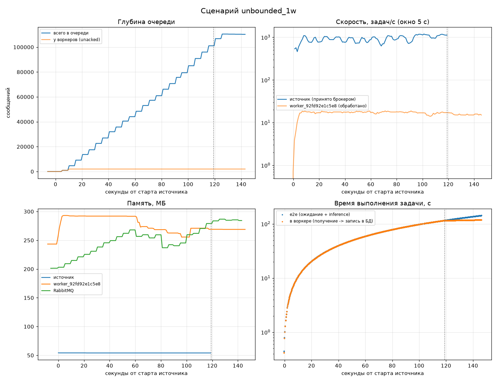
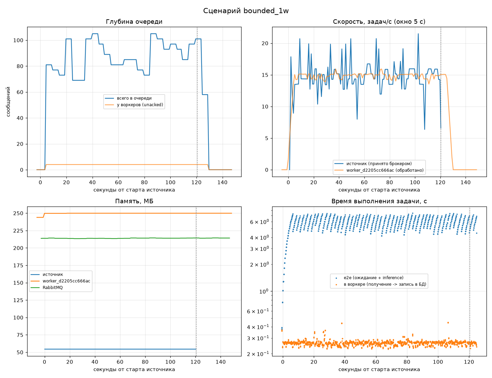
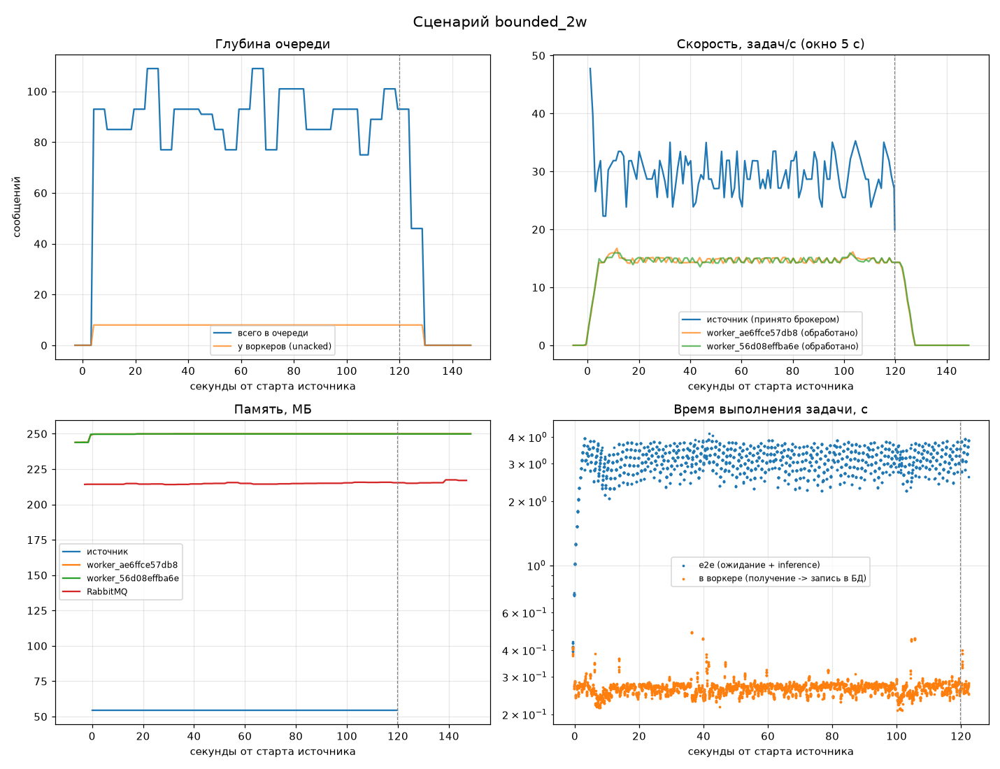
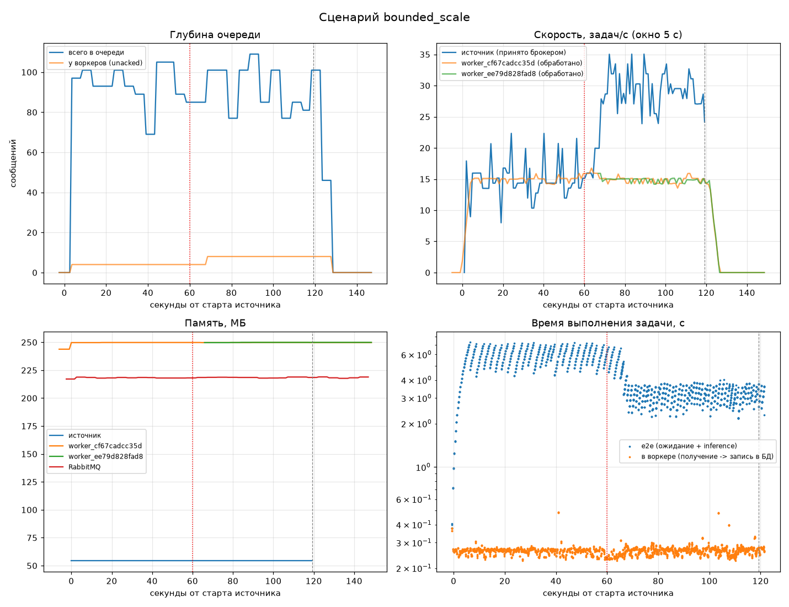
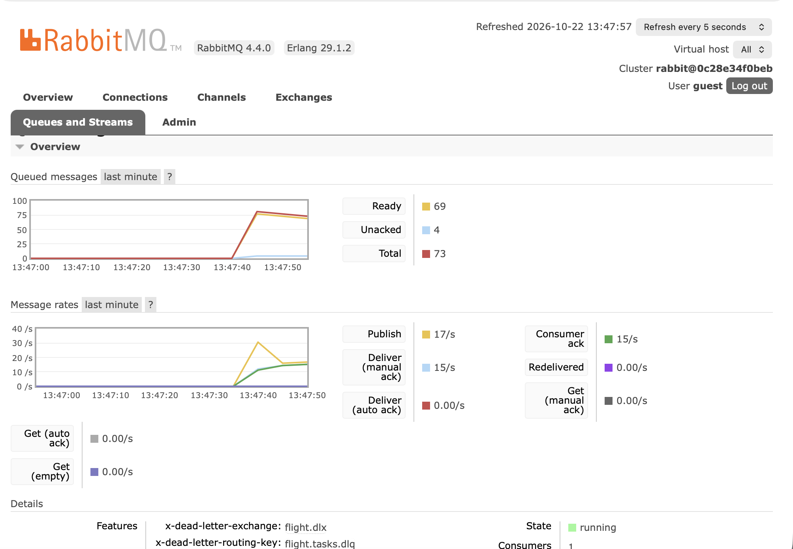

# Flight Delay MLOps

Учебный MLOps-проект с асинхронным FastAPI-приложением и PostgreSQL.

Проект демонстрирует полный цикл разработки и поставки приложения:

```text
Разработка
    ↓
Git
    ↓
pre-commit
    ↓
CI
    ↓
Docker
    ↓
CD
    ↓
GitHub Container Registry
```

## 1. Что представляет собой проект

Приложение предоставляет HTTP API для проверки состояния сервиса и его зависимостей.

Основные компоненты:

- **FastAPI** — веб-фреймворк для создания API;
- **PostgreSQL** — база данных;
- **asyncpg** — асинхронный драйвер PostgreSQL;
- **uv** — управление Python-зависимостями и окружением;
- **Docker** — контейнеризация приложения;
- **Docker Compose** — запуск приложения вместе с PostgreSQL;
- **pytest** — тестирование;
- **Ruff** — линтинг и форматирование;
- **pre-commit** — автоматические проверки перед commit;
- **GitHub Actions** — CI/CD;
- **GitHub Container Registry (GHCR)** — хранение Docker-образов.

Приложение является асинхронным: API реализован через `async def`, а операции с PostgreSQL выполняются через асинхронный драйвер `asyncpg`.

---

# 2. Структура проекта

```text
flight-delay-mlops/
│
├── src/
│   └── flight_delay_mlops/
│       ├── __init__.py
│       ├── main.py
│       └── database.py
│
├── tests/
│   ├── test_api.py
│   └── test_database.py
│
├── .github/
│   └── workflows/
│       ├── ci.yml
│       └── cd.yml
│
├── .pre-commit-config.yaml
├── .python-version
├── Dockerfile
├── docker-compose.yml
├── pyproject.toml
├── uv.lock
└── README.md
```

## Назначение основных файлов

### `src/flight_delay_mlops/main.py`

Основной модуль FastAPI-приложения.

Здесь находятся:

- создание объекта `FastAPI`;
- HTTP endpoints;
- проверка состояния приложения;
- получение версии приложения;
- end-to-end health-check;
- обработка ошибок при недоступности PostgreSQL;
- логирование HTTP-запросов.

### `src/flight_delay_mlops/database.py`

Модуль для работы с PostgreSQL.

В нём находится функция `check_database()`, которая:

1. подключается к PostgreSQL через `asyncpg`;
2. выполняет запрос `SELECT version()`;
3. возвращает версию PostgreSQL;
4. закрывает соединение после завершения операции.

Адрес базы данных берётся из переменной окружения `DATABASE_URL`.

Если переменная окружения не задана, используется локальный адрес PostgreSQL.

### `tests/test_api.py`

Тесты HTTP API.

Проверяются:

- `/healthz`;
- `/api/v1/version`;
- успешный `/api/v1/health`;
- сценарий недоступной базы данных.

### `tests/test_database.py`

Тесты функции работы с PostgreSQL.

Проверяются:

- успешное получение версии PostgreSQL;
- обработка ошибки базы данных;
- закрытие соединения.

### `Dockerfile`

Описывает сборку Docker-образа приложения.

В контейнер устанавливаются runtime-зависимости и исходный код приложения.

Приложение запускается от отдельного пользователя `appuser`, а не от `root`.

### `docker-compose.yml`

Описывает локальную инфраструктуру проекта.

Запускаются два сервиса:

```text
app
 ↓
FastAPI

db
 ↓
PostgreSQL
```

Compose также настраивает:

- сеть между контейнерами;
- PostgreSQL volume;
- healthcheck базы данных;
- порты;
- ограничения CPU и памяти;
- ограничения Docker logs;
- зависимость приложения от готовности базы данных.

### `pyproject.toml`

Основной файл конфигурации Python-проекта.

В нём находятся:

- метаданные проекта;
- версия приложения;
- зависимости;
- группы зависимостей;
- настройки Ruff;
- настройки pytest.

### `uv.lock`

Lock-файл с зафиксированными версиями зависимостей.

Он используется для воспроизводимой установки окружения.

### `.pre-commit-config.yaml`

Конфигурация автоматических проверок перед commit.

### `.github/workflows/ci.yml`

GitHub Actions workflow для Continuous Integration.

### `.github/workflows/cd.yml`

GitHub Actions workflow для Continuous Delivery.

---

# 3. Установка зависимостей

Проект использует `uv`.

Для установки зависимостей:

```bash
uv sync
```

`uv.lock` используется для воспроизводимой установки зависимостей.

---

# 4. Запуск PostgreSQL

Для локальной разработки можно запустить только базу данных:

```bash
docker compose up -d db
```

Проверить состояние:

```bash
docker compose ps
```

PostgreSQL должен иметь состояние:

```text
healthy
```

Параметры базы данных:

```text
Database: flight_delay
User: postgres
Password: postgres
Port: 5432
```

---

# 5. Запуск приложения локально

После запуска PostgreSQL:

```bash
uv run uvicorn flight_delay_mlops.main:app --reload
```

Приложение будет доступно по адресу:

```text
http://127.0.0.1:8000
```

Swagger UI:

```text
http://127.0.0.1:8000/docs
```

---

# 6. Запуск всего проекта через Docker Compose

Для запуска приложения и PostgreSQL вместе:

```bash
docker compose up -d --build
```

Проверить контейнеры:

```bash
docker compose ps
```

Ожидаемая структура:

```text
app   → FastAPI → port 8000
db    → PostgreSQL → port 5432
```

Посмотреть логи приложения:

```bash
docker compose logs app --tail=20
```

Посмотреть логи PostgreSQL:

```bash
docker compose logs db --tail=20
```

Остановить проект:

```bash
docker compose down
```

---

# 7. Docker Compose и PostgreSQL

Приложение и PostgreSQL запускаются в разных контейнерах.

```text
┌──────────────────────┐
│        app           │
│      FastAPI         │
│       :8000          │
└──────────┬───────────┘
           │
           │ Docker network
           │
┌──────────▼───────────┐
│         db           │
│     PostgreSQL       │
│       :5432          │
└──────────────────────┘
```

Внутри Docker Compose приложение обращается к PostgreSQL по имени сервиса:

```text
db
```

а не через `localhost`.

Переменная окружения:

```text
DATABASE_URL=postgresql://postgres:postgres@db:5432/flight_delay
```

---

# 8. Healthcheck PostgreSQL

PostgreSQL имеет Docker healthcheck:

```text
pg_isready -U postgres -d flight_delay
```

Он проверяет, готова ли база принимать подключения.

Приложение зависит от готовности базы:

```yaml
depends_on:
  db:
    condition: service_healthy
```

Поэтому Compose сначала ждёт, пока PostgreSQL станет `healthy`, и только после этого запускает приложение.

---

# 9. API

В приложении реализовано три основных endpoint'а.

## `GET /healthz`

Быстрая проверка того, что само приложение отвечает.

Ответ:

```json
{
  "status": "ok"
}
```

Endpoint находится вне `/api/v1`, потому что это отдельный healthcheck для проверки доступности самого приложения, а не версионируемый бизнес/API endpoint.

---

## `GET /api/v1/version`

Возвращает версию приложения.

Пример:

```json
{
  "version": "0.1.1"
}
```

Версия берётся из метаданных установленного Python-пакета через:

```python
importlib.metadata.version()
```

Версия проекта хранится в `pyproject.toml`.

Чтобы изменить версию:

1. изменить `version` в `pyproject.toml`;
2. выполнить:

```bash
uv lock
```

3. запустить тесты и проверки;
4. создать commit;
5. выполнить `git push`.

---

## `GET /api/v1/health`

End-to-end health-check.

Endpoint проверяет доступность PostgreSQL и получает версию базы данных.

Пример успешного ответа:

```json
{
  "status": "ok",
  "database": "PostgreSQL 17...",
  "response_time_ms": 35.24
}
```

`response_time_ms` показывает время выполнения проверки.

Если PostgreSQL недоступен, endpoint возвращает:

```text
HTTP 503 Service Unavailable
```

Например:

```json
{
  "status": "error",
  "database": "unavailable",
  "response_time_ms": 10.42
}
```

Это позволяет отличить работающий FastAPI-сервис от ситуации, когда его зависимость PostgreSQL недоступна.

---

# 10. Асинхронность

Приложение использует асинхронные endpoint'ы:

```python
async def
```

и `await`.

Для PostgreSQL используется асинхронный драйвер:

```text
asyncpg
```

Цепочка работы:

```text
FastAPI
   ↓
async def
   ↓
await
   ↓
asyncpg
   ↓
PostgreSQL
```

Асинхронность позволяет не блокировать event loop во время операций ввода-вывода.

---

# 11. Обработка ошибок

При обращении к PostgreSQL могут возникать ошибки.

В `/api/v1/health` обрабатываются ошибки:

```python
asyncpg.PostgresError
OSError
```

Если база недоступна, приложение не отдаёт необработанный traceback клиенту.

Вместо этого возвращается:

```text
503 Service Unavailable
```

и понятный JSON-ответ.

---

# 12. Тестирование

Запустить тесты:

```bash
uv run pytest
```

Запустить тесты с coverage:

```bash
uv run pytest --cov=flight_delay_mlops --cov-report=term-missing
```

Текущий результат:

```text
6 passed
98% coverage
```

Покрываются:

- API endpoints;
- успешный health-check;
- ошибочный health-check;
- работа с PostgreSQL;
- обработка ошибок базы;
- закрытие соединения.

---

# 13. Ruff

Для проверки качества Python-кода используется Ruff.

Проверка линтера:

```bash
uv run ruff check .
```

Проверка форматирования:

```bash
uv run ruff format --check .
```

Ruff используется для:

- поиска проблем в коде;
- проверки стиля;
- форматирования Python-файлов.

---

# 14. Pre-commit

Перед commit автоматически запускаются проверки из `.pre-commit-config.yaml`.

В проекте используются проверки:

```text
trim trailing whitespace
end-of-file-fixer
check added large files
check YAML
check TOML
Ruff check
Ruff format
```

Установка hooks:

```bash
uv run pre-commit install
```

Запуск всех проверок вручную:

```bash
uv run pre-commit run --all-files
```

Если hook изменил файл автоматически, изменения нужно добавить в Git и повторить commit.

---

# 15. Git

Основная ветка проекта:

```text
main
```

Обычный workflow:

```text
изменение кода
      ↓
git status
      ↓
git add
      ↓
git commit
      ↓
pre-commit
      ↓
git push origin main
```

Пример:

```bash
git status
git add .
git commit -m "feat: update healthcheck"
git push origin main
```

---

# 16. CI

CI означает Continuous Integration.

В проекте CI реализован через GitHub Actions.

После push в `main` запускается workflow:

```text
git push
    ↓
GitHub Actions
    ↓
uv sync
    ↓
Ruff check
    ↓
Ruff format check
    ↓
pytest
    ↓
coverage
```

CI нужен для автоматической проверки нового кода.

Если проверки не проходят, CI становится красным.

Если все проверки проходят, workflow завершается успешно.

---

# 17. CD

CD означает Continuous Delivery.

В нашем проекте CD запускается после успешного завершения CI.

Общий процесс:

```text
push в main
      ↓
     CI
      ↓
  CI success
      ↓
     CD
      ↓
 Docker build
      ↓
 Docker image
      ↓
     GHCR
```

Если CI завершился с ошибкой, CD не публикует новый Docker-образ.

---

# 18. GitHub Container Registry

Docker-образы проекта публикуются в GitHub Container Registry:

```text
ghcr.io/s3polina/flight-delay-mlops
```

Используется два типа тегов:

```text
latest
```

и

```text
<commit_sha>
```

### `latest`

Указывает на последнюю опубликованную версию из `main`.

### Commit SHA

Позволяет точно определить, из какого commit был собран конкретный Docker-образ.

Например:

```text
ghcr.io/s3polina/flight-delay-mlops:latest

ghcr.io/s3polina/flight-delay-mlops:f8c1acf...
```

SHA-тег позволяет связать Docker-образ с конкретным состоянием исходного кода.

---

# 19. Logging

Приложение логирует HTTP-запросы.

В логах сохраняются:

- HTTP method;
- request path;
- HTTP status code;
- response time.

Пример:

```text
INFO request method=GET path=/api/v1/health status_code=200 response_time_ms=35.24
```

Это позволяет понимать, какие запросы приходят в приложение и сколько времени они выполняются.

---

# 20. Docker image

Для приложения используется Docker image на базе:

```text
python:3.12-slim
```

В образ устанавливаются runtime-зависимости приложения.

Для установки зависимостей используется `uv`.

Приложение запускается от отдельного пользователя:

```text
appuser
```

а не от `root`.

Это уменьшает права процесса внутри контейнера.

---

# 21. Docker resources and logging

В Docker Compose для сервисов заданы ограничения ресурсов:

```text
CPU: 1
Memory: 512 MB
```

Также настроено ограничение Docker logs:

```text
max-size: 10m
max-file: 3
```

Это предотвращает бесконтрольный рост логов контейнеров.

---

# 22. PostgreSQL volume

PostgreSQL использует Docker volume:

```text
postgres_data
```

Volume монтируется в:

```text
/var/lib/postgresql/data
```

Это позволяет сохранять данные PostgreSQL независимо от жизненного цикла контейнера.

---

# 23. Полный workflow проекта

Итоговый процесс выглядит так:

```text
                    Developer
                        │
                        ▼
                  Code changes
                        │
                        ▼
                     Git
                        │
                        ▼
                  pre-commit
                        │
                        ▼
                  git push main
                        │
                        ▼
                 ┌─────────────┐
                 │     CI      │
                 │             │
                 │ Ruff        │
                 │ Format      │
                 │ Tests       │
                 │ Coverage    │
                 └──────┬──────┘
                        │
                    success
                        │
                        ▼
                 ┌─────────────┐
                 │     CD      │
                 │             │
                 │ Docker build│
                 │     ↓       │
                 │    GHCR     │
                 └─────────────┘
```

---

# 24. Полный запуск с нуля

Если нужно полностью запустить проект:

```bash
git clone https://github.com/s3polina/flight-delay-mlops.git
cd flight-delay-mlops
```

Установить зависимости:

```bash
uv sync
```

Запустить всё:

```bash
docker compose up -d --build
```

Проверить состояние:

```bash
docker compose ps
```

Проверить API:

```text
http://127.0.0.1:8000/docs
```

Проверить health:

```text
http://127.0.0.1:8000/healthz
```

Проверить версию:

```text
http://127.0.0.1:8000/api/v1/version
```

Проверить PostgreSQL:

```text
http://127.0.0.1:8000/api/v1/health
```

---

# 25. Остановка проекта

Остановить контейнеры:

```bash
docker compose down
```

Если нужно удалить также volume PostgreSQL:

```bash
docker compose down -v
```

Команда `down -v` удаляет сохранённые данные PostgreSQL, поэтому использовать её нужно только когда данные больше не нужны.

---

# 26. Основная идея проекта

Проект демонстрирует не только создание FastAPI-приложения, но и весь базовый процесс его подготовки к поставке:

```text
Код
 ↓
Проверка качества
 ↓
Тестирование
 ↓
Контейнеризация
 ↓
CI
 ↓
CD
 ↓
Docker Registry
```

Главная цель — сделать процесс воспроизводимым и автоматизировать проверки и публикацию приложения.

---

# 27. MLflow: от данных до inference (ДЗ 3)

## Что получилось

```text
nycflights13 (сырые данные)
    ↓  ml/prepare_data.py
data/flights_2013.csv  ──►  MLflow Dataset (source + digest)
    ↓  ml/eda.py, ml/train.py
Experiment "flight-delay"  ──►  Runs: eda, baseline_logreg, logreg_onehot, hgb_default, hgb_tuned
    ↓                               (params, metrics, artifacts, logged model)
Model Registry: flight-delay-classifier  v1, v2, ...  + alias @champion
    ↓  загрузка 1 раз при старте
FastAPI  ──►  POST /process
```

**Задача:** по данным рейса, известным до вылета, предсказать вероятность того,
что прилёт задержится больше чем на 15 минут (бинарная классификация).

## Архитектура MLflow

```text
           ┌──────────────── docker compose ────────────────┐
 браузер ─►│ mlflow (Tracking Server + UI, :5000)           │
 скрипты ─►│   ├─ Backend Store  → mlflow-db (PostgreSQL)   │  метаданные: эксперименты, runs,
 app     ─►│   │                                            │  параметры, метрики, датасеты,
           │   │                                            │  Model Registry, aliases
           │   └─ Artifact Store → том mlflow_artifacts     │  файлы: модели, графики, отчёты
           │                      (/mlartifacts)            │
           └────────────────────────────────────────────────┘
```

- **Backend Store** — PostgreSQL `mlflow-db` (отдельный от БД приложения `db`).
- **Artifact Store** — отдельный Docker-том `mlflow_artifacts`, смонтированный
  в контейнер сервера как `/mlartifacts` (`--artifacts-destination /mlartifacts`).
- Сервер запущен с `--serve-artifacts`: клиенты (скрипты, приложение) работают
  **только** с `http://localhost:5000`, а файлы сервер сам сохраняет в хранилище
  и отдаёт оттуда. Клиентам не нужен прямой доступ к хранилищу.
- В продакшене Artifact Store обычно S3-совместимый (Amazon S3, MinIO и т.п.):
  меняется только `--artifacts-destination s3://bucket`, клиентский код тот же.
  От MinIO в compose отказались: его образы больше не публикуются на Docker Hub.
- `--allowed-hosts` — в MLflow 3 сервер проверяет заголовок Host;
  разрешаем `localhost` (UI, скрипты) и `mlflow` (запросы из контейнера `app`).
- Образ сервера собирается из `mlflow-server/Dockerfile`
  (MLflow + `psycopg2` для PostgreSQL).

Адреса:

| Что | URL |
|-----|-----|
| MLflow UI | http://localhost:5000 |
| Приложение, Swagger | http://localhost:8000/docs |

## Запуск с нуля

```bash
# 1. Зависимости (группа ml - для скриптов обучения)
uv sync --all-groups

# 2. Поднять MLflow (+ PostgreSQL) и приложение
docker compose up -d --build

# 3. Данные -> EDA -> эксперименты
uv run python ml/prepare_data.py
uv run python ml/eda.py
uv run python ml/train.py

# 4. Model Registry: две версии модели
uv run python ml/register.py --run-name logreg_onehot --alias challenger   # v1
uv run python ml/register.py --best --alias champion                       # v2 (hgb_tuned)

# 5. Перезапустить приложение, чтобы оно загрузило @champion
docker compose restart app
```

> При первом `docker compose up` модели в Registry ещё нет: приложение стартует,
> пишет ошибку в лог, а `/process` отвечает `503`. После шага 4 достаточно `restart app`.

Скрипты по умолчанию ходят в `http://localhost:5000`
(можно переопределить через `MLFLOW_TRACKING_URI`).

## Файлы

| Файл | Что делает |
|------|-----------|
| `ml/prepare_data.py` | берёт `nycflights13.flights`, убирает рейсы без прилёта (отменённые), строит целевую `is_delayed`, сохраняет `data/flights_2013.csv` |
| `ml/eda.py` | Run `eda`: графики и выводы → артефакты `eda/` |
| `ml/train.py` | 4 Run'а: baseline + 3 варианта, метрики, диагностика, модель |
| `ml/register.py` | регистрирует модель из Run как новую версию + ставит alias |
| `ml/set_alias.py` | переключает alias на другую версию |
| `ml/common.py` | общие настройки (URI, имена, путь к данным, датасет MLflow) |
| `src/flight_delay_mlops/features.py` | признаки; используются и в обучении, и в приложении |
| `src/flight_delay_mlops/model.py` | загрузка модели из Registry по alias |
| `src/flight_delay_mlops/schemas.py` | схемы запроса/ответа `/process` |

## EDA

Run `eda` в эксперименте `flight-delay`, артефакты в папке `eda/`:
баланс классов, распределение задержки, доля задержек по часу вылета,
месяцу, дню недели, авиакомпании и по дням года, `describe`, `conclusions.md`.

Главные выводы:

- задержано ~24% рейсов → классы несбалансированы, accuracy не подходит как основная метрика;
- **час вылета** — сильнейший понятный признак: утром ~10% задержек, вечером ~35%;
- сезонность (хуже всего декабрь и лето, лучше всего сентябрь), разница между авиакомпаниями;
- задержки **кучкуются по дням** (от 4% до 79% за день — погода, сбои);
- берём только признаки, известные **до вылета**. `dep_delay` и `air_time` не используем —
  это утечка целевой переменной.

## Dataset Tracking: source, digest, lineage

Датасет логируется через `mlflow.data.from_pandas(...)` и `mlflow.log_input(...)`:

- **name** — `nycflights13-2013` (EDA), `nycflights13-2013-train`, `nycflights13-2013-test`;
- **source** — откуда данные: путь к `data/flights_2013.csv`
  (а он получен из пакета `nycflights13`, это записано в `prepare_stats.json` в артефактах EDA);
- **digest** — хеш содержимого датасета, MLflow считает его сам.
  Изменились данные → изменился digest → видно, что Run'ы обучены на разных данных;
- **context** — роль датасета в Run: `eda`, `training`, `testing`;
- **targets** — целевая колонка `is_delayed`; в UI видна схема и профиль (число строк).

**Lineage (происхождение):**

```text
Model version (Registry) → Logged model (model_id) → Run → Datasets (training/testing) → source
```

По версии модели в Registry видно, из какого Run она пришла; в Run — на каких датасетах
(по digest) она обучена и с какими параметрами; метрики в MLflow 3 дополнительно
привязаны к модели (`model_id`) и к тестовому датасету.

## Experiments & Runs

Эксперимент `flight-delay`, одно и то же разбиение train/test 80/20 (`random_state=42`, stratify):

| Run | Что меняем | ROC-AUC | PR-AUC | F1 |
|-----|-----------|---------|--------|----|
| `baseline_logreg` | логрегрессия на 3 числовых признаках | ~0.63 | ~0.32 | 0.00 |
| `logreg_onehot` | + все признаки, one-hot, `class_weight=balanced` | ~0.65 | ~0.35 | ~0.43 |
| `hgb_default` | нелинейная модель: HistGradientBoosting | ~0.77 | ~0.57 | ~0.39 |
| `hgb_tuned` | бустинг: 500 деревьев, 63 листа, L2, `balanced` | ~0.80 | ~0.60 | ~0.56 |

У baseline F1 = 0: без учёта дисбаланса модель ни разу не даёт вероятность > 0.5
и предсказывает «вовремя» для всех — именно поэтому accuracy (~0.76) обманчива.

Сравнение в UI: эксперимент → выделить Run'ы → **Compare** (таблица параметров/метрик,
графики parallel coordinates / scatter).

## Метрики и артефакты

- **Основная метрика — ROC-AUC**: не зависит от порога и от дисбаланса классов,
  показывает, насколько хорошо модель ранжирует рейсы по риску задержки.
- Вспомогательные: **PR-AUC** (качество на редком классе), **F1 / precision / recall**
  при пороге 0.5, `accuracy` (для сравнения, почему она плохая), `log_loss`
  (качество вероятностей), `train_roc_auc` (проверка на переобучение).
- Диагностические артефакты каждого Run (`diagnostics/`): ROC- и PR-кривые,
  confusion matrix, калибровка, permutation importance, classification report.
- Модель (`model/`): sklearn Pipeline целиком (признаки → препроцессинг → модель),
  с signature и input example.

Наблюдение по permutation importance: самый важный признак — дата рейса.
Модель «запоминает» плохие дни, потому что train и test перемешаны случайно.
В реальной задаче нужно делить данные по времени (train — раньше, test — позже).

Модель сохраняется в формате `cloudpickle`, а не `skops` (формат по умолчанию):
skops не умеет сериализовать нашу функцию `add_features` внутри Pipeline.
Pickle-форматы исполняют код при загрузке, поэтому грузить модели можно только
из доверенного Registry.

## Model Registry и alias

- Зарегистрированная модель: `flight-delay-classifier`.
- Каждый `register.py` создаёт новую **версию** (v1, v2, ...). У версии есть ссылка
  на Run (`run_id`), описание и теги (`run_name`, `roc_auc`).
- **Alias** — именованный указатель на версию: `@champion` — рабочая модель,
  `@challenger` — кандидат. Alias можно переставить на другую версию одной командой
  или в UI, не меняя код.

```bash
uv run python ml/set_alias.py --alias champion --version 1
```

## Inference: `POST /process`

При старте приложения (FastAPI `lifespan`) модель загружается **один раз**:

1. `MlflowClient().get_model_version_by_alias("flight-delay-classifier", "champion")` →
   конкретный номер версии;
2. `mlflow.pyfunc.load_model("models:/flight-delay-classifier/<version>")`;
3. модель и её версия хранятся в `app.state.model`.

`POST /process` только вызывает уже загруженную модель (в отдельном потоке
через `asyncio.to_thread`, чтобы не блокировать event loop) и возвращает,
какая версия ответила. Настройки — переменные окружения
`MLFLOW_TRACKING_URI`, `MODEL_NAME`, `MODEL_ALIAS`, `DELAY_THRESHOLD`.

```bash
curl -X POST http://localhost:8000/process \
  -H "Content-Type: application/json" \
  -d '{
    "flights": [
      {"flight_date": "2013-12-20", "sched_dep_time": 1830, "sched_arr_time": 2135,
       "carrier": "EV", "origin": "EWR", "dest": "ATL", "distance": 746},
      {"flight_date": "2013-09-10", "sched_dep_time": 600, "sched_arr_time": 830,
       "carrier": "DL", "origin": "LGA", "dest": "ATL", "distance": 762}
    ]
  }'
```

```json
{
  "model": {"name": "flight-delay-classifier", "alias": "champion", "version": "2", "run_id": "..."},
  "predictions": [
    {"delay_probability": 0.857, "is_delayed": true},
    {"delay_probability": 0.128, "is_delayed": false}
  ]
}
```

Какая версия сейчас работает: `GET /api/v1/model` (или поле `model` в ответе `/process`).

## Сценарий защиты: переключение версии

```bash
curl http://localhost:8000/api/v1/model                     # version: 2
uv run python ml/set_alias.py --alias champion --version 1  # или в UI MLflow
curl http://localhost:8000/api/v1/model                     # всё ещё 2!
docker compose restart app
curl http://localhost:8000/api/v1/model                     # version: 1
```

Inference-код не меняется: приложение всегда грузит то, на что указывает `@champion`.

## Проблема «горячего обновления» и как лучше

Приложение узнаёт о новом alias **только при перезапуске**. Кажется, что проще сделать
«горячее обновление» — периодически опрашивать Registry и подменять модель на лету.
Проблемы такого подхода:

- **неконсистентность**: несколько реплик сервиса обновятся в разное время и какое-то время
  будут отвечать разными моделями; непонятно, какая версия ответила на конкретный запрос;
- **нет контроля релиза**: кто-то переставил alias в UI — и модель в проде сменилась
  без тестов, без ревью и без возможности плавно откатиться;
- **риски во время подмены**: загрузка новой модели в работающий процесс — это
  нагрузка на CPU/память (две модели в памяти одновременно), гонки между запросами
  и подменой, а если загрузка упала — сервис в непонятном состоянии;
- **несовместимость**: новая версия может требовать другие зависимости или другой
  формат входа, а код и окружение приложения остались старыми;
- **воспроизводимость**: состояние сервиса зависит от того, «когда он опросил Registry»,
  а не от версии деплоя.

Как лучше:

- **версия модели — часть деплоя**: смена alias запускает CI/CD (webhook Model Registry
  или ручной триггер), который прогоняет проверки и делает **rolling restart / новый релиз**;
  ещё надёжнее — фиксировать конкретную версию (`models:/name/5`) в конфиге релиза или
  «запекать» модель в Docker-образ;
- **blue-green / canary**: новая версия поднимается рядом со старой, на неё переводят
  часть трафика, сравнивают метрики, и только потом переключают всё;
- **readiness probe**: под принимает трафик только после успешной загрузки модели;
- версия модели возвращается в ответе и пишется в логи — всегда видно, кто ответил.

---

# 28. Противодавление в конвейере задач (ДЗ 4)

## Что получилось

```text
data/flights_2013.csv (327 тыс. рейсов)        внешний клиент
    ↓  source.py                                    ↓  POST /api/v1/tasks
    └────────────────┬──────────────────────────────┘
                     ↓  публикация с подтверждением брокера
     RabbitMQ: очередь flight.tasks, максимум 100 задач
                     ↓  каждому воркеру не больше 4 задач за раз
     worker.py: модель @champion из MLflow, 4 потока
                     ↓
     PostgreSQL: таблица tasks (результаты)

 сообщение, которое не удалось обработать 4 раза  →  flight.tasks.dlq
```

**Идея:** источник задач работает в десятки раз быстрее воркера. Чтобы очередь не росла бесконечно, медленный воркер сам притормаживает быстрый источник: очередь ограничена, и когда она полна, брокер отказывает источнику, а тот ждёт и повторяет. Внешнего клиента API притормозить нельзя, поэтому ему сразу отвечаем `503`.

Результат эксперимента (подробно ниже):

| | без ограничений | с ограничениями, 1 воркер | с ограничениями, 2 воркера |
|---|---|---|---|
| скорость источника, задач/с | 954 | 14,7 | 29,4 |
| скорость воркеров, задач/с | 17 | 14,9 | 29,3 |
| задач в очереди, максимум | 101 043 | 105 | 109 |
| время выполнения задачи, с | 65 и растёт | 5,9 | 3,2 |

## Запуск

```bash
uv sync --all-groups
docker compose up -d --build

export MLFLOW_TRACKING_URI=http://localhost:5001
uv run python ml/prepare_data.py
uv run python ml/train.py --config hgb_tuned
uv run python ml/register.py --best --alias champion
docker compose restart worker

docker compose --profile load run --rm source
```

| Что | Где |
|---|---|
| RabbitMQ Management UI | http://localhost:15672 (guest / guest) |
| MLflow UI | http://localhost:5001 (порт 5000 на macOS занят AirPlay) |
| Swagger API | http://localhost:8000/docs |
| Health-check воркера | `curl localhost:$(docker compose port worker 8001 \| cut -d: -f2)/health` |

Все параметры задаются переменными окружения, код менять не нужно:

| Переменная | По умолчанию | Что это |
|---|---|---|
| `QUEUE_MAX_LENGTH` | 100 | сколько задач помещается в очередь |
| `PREFETCH_COUNT` | 4 | сколько задач брокер выдаёт одному воркеру за раз |
| `WORKER_CONCURRENCY` | 4 | сколько потоков у воркера для inference |
| `INFERENCE_DELAY_SEC` | 0.2 | сколько секунд длится inference |
| `DELIVERY_LIMIT` | 3 | сколько повторных попыток после первой неудачи, потом DLQ |

## Файлы

| Файл | Что делает |
|---|---|
| `src/flight_delay_mlops/config.py` | все настройки из переменных окружения |
| `src/flight_delay_mlops/messaging.py` | объявляет очередь, DLQ и публикует задачу с подтверждением брокера |
| `src/flight_delay_mlops/source.py` | источник: читает CSV по одной строке и публикует задачи |
| `src/flight_delay_mlops/worker.py` | воркер на FastStream: inference и запись результата, `/health` |
| `src/flight_delay_mlops/storage.py` | таблица `tasks` в PostgreSQL |
| `src/flight_delay_mlops/main.py` | API: `POST /api/v1/tasks`, `GET /api/v1/tasks/{task_id}` |
| `src/flight_delay_mlops/metrics.py` | раз в секунду пишет метрики процесса в CSV |
| `experiments/run_scenario.sh` | один прогон эксперимента |
| `experiments/monitor.py` | снимает глубину очереди и память RabbitMQ |
| `experiments/analyze.py` | строит графики и сводную таблицу |

## 1. Архитектура

- Источник, воркер и API — разные процессы (разные сервисы в `docker-compose.yml`). Друг с другом они общаются только через RabbitMQ.
- Воркер загружает модель **один раз** при старте, до того как начнёт читать очередь. Версию выбирает по alias: `MODEL_NAME=flight-delay-classifier`, `MODEL_ALIAS=champion`. Номера версии в коде нет: переключили alias в MLflow, перезапустили воркер, и он работает с новой версией.
- Время inference задаётся `INFERENCE_DELAY_SEC`, поэтому эксперименты повторяемы.

## 2. Брокер → воркер: `prefetch_count`

**`prefetch_count = 4`, потому что у воркера 4 потока** (`WORKER_CONCURRENCY = 4`). Одновременно он может считать только 4 задачи, значит и держать у себя больше 4 смысла нет.

Что будет при другом значении:
- **больше 4** (например, 100): лишние 96 задач просто лежат в памяти воркера и ждут. Быстрее не становится, зато второй воркер их не получит, при падении все 100 придётся передоставлять, а очередь в RabbitMQ выглядит короче, чем есть на самом деле. В эксперименте без ограничений воркер набрал 2000 задач, и время «внутри воркера» выросло с 0,26 с до 65 с;
- **меньше 4**: часть потоков простаивает.

Один воркер обрабатывает 4 / 0,26 с ≈ **15 задач в секунду**: 0,2 с задержка плюс ~0,06 с на саму модель и запись в БД.

**Inference не блокирует event loop.** Модель sklearn синхронная, поэтому вызывается в отдельном потоке (`loop.run_in_executor`). Пока потоки считают, воркер продолжает отвечать на `/health`: ответ приходит мгновенно и показывает `"in_flight": 4`.

## 3. Воркер → источник: ограниченная очередь

**Как работает:**
1. Очередь `flight.tasks` вмещает 100 задач (`x-max-length = 100`).
2. Когда она полна, RabbitMQ не принимает новую задачу и отвечает источнику отказом (`x-overflow: reject-publish`, сигнал приходит через publisher confirms).
3. Источник получил отказ, ждёт (50 мс, 100 мс, 200 мс… до 2 с) и отправляет **ту же** задачу снова.
4. Источник читает файл по одной строке и не берёт следующую, пока брокер не принял текущую. Поэтому в памяти источника всегда одна задача, а память не растёт: 54 МБ в любом режиме.

В итоге источник отправляет задачу ровно тогда, когда воркер освободил место. Его скорость сама становится равной скорости воркеров, без ручной настройки. Добавили второй воркер — место освобождается вдвое быстрее, и источник сам ускоряется вдвое.

**Почему выбран этот способ:**

| Другой способ | Почему не он |
|---|---|
| Ограничить частоту источника («не больше 15 задач/с») | это rate limiting, а не противодавление: число подбирается вручную и не меняется, если воркеров стало больше или меньше |
| Источник сам спрашивает глубину очереди через Management API | данные приходят с опозданием на несколько секунд, лишний HTTP-запрос, и пока мы спрашивали, очередь могла заполниться. Наш сигнал приходит в ответ на каждую публикацию, сразу |
| Режим переполнения по умолчанию (`drop-head`) | брокер молча выбрасывает самые старые задачи, задачи теряются |
| Складывать задачи в память источника | перегрузка просто переезжает из брокера в источник, память растёт |

**Две особенности RabbitMQ, которые видно в Management UI:**
- в лимит 100 входят только задачи в ожидании (Ready). Задачи, которые сейчас у воркеров (Unacked), не считаются, поэтому Total = до 100 + 4 на каждый воркер;
- у quorum-очереди лимит проверяется сразу после записи задачи, поэтому одна лишняя задача всё же проходит: максимум Ready = 101. Classic-очередь считает точно, но не умеет ограничивать число попыток обработки (см. раздел 5), поэтому выбрана quorum.

## 4. Граница системы: `503` для внешнего клиента

`POST /api/v1/tasks` принимает рейс и возвращает `202` и `task_id`. Результат: `GET /api/v1/tasks/{task_id}`. Если очередь полна, API **сразу** отвечает `503` с заголовком `Retry-After: 5`.

- **После `503` в БД нет задачи PENDING.** Запись задачи в БД и отправка в RabbitMQ идут внутри одной транзакции. Брокер отказал — транзакция откатывается, записи нет.
- **Запрос не зависает.** Ответ брокера ждём не больше 2 секунд, потом `503`.
- **Почему `Retry-After` 5 секунд.** Это время, за которое один воркер полностью обновляет очередь: 100 задач × 0,2 с / 4 потока = 5 с. Раньше повторять почти бесполезно: очередь та же. Замеры: с одним воркером очередь обновляется за 6,5 с, с двумя за 3,3 с, 5 с между ними. Число не подобрано вручную, оно считается из настроек (`config.py`) и само меняется вместе с лимитом очереди.
- **Повтор запроса с тем же заголовком `Idempotency-Key`** не создаёт вторую задачу.

**Почему это load shedding, а не backpressure.** Противодавление — когда медленная часть замедляет быструю. Источник — наша программа, мы можем заставить его ждать. Внешний клиент — чужая программа, его замедлить нельзя. Если бы API держал запрос, пока не освободится место, перегрузка просто переехала бы в API: висят соединения, растёт память, у клиентов таймауты. Поэтому лишнюю нагрузку мы **сбрасываем**: сразу отказываем и не принимаем задачу. `Retry-After` — только подсказка, клиент может её проигнорировать.

## 5. Ошибки и надёжность

**Как воркер подтверждает задачи** (`ack_policy = REJECT_ON_ERROR`):

| Что случилось | Что делает воркер | Что делает RabbitMQ |
|---|---|---|
| результат записан в БД | `ack` | удаляет задачу |
| ошибка (БД недоступна, модель упала) | `reject` с возвратом в очередь | считает неудачи, после 4-й попытки (1 + 3 повтора) → DLQ |
| сообщение не по формату | `reject` без возврата | сразу в DLQ |
| непредвиденная ошибка | `reject` без возврата | сразу в DLQ (не бесконечный цикл) |

`ack` отправляется только **после** записи в БД. Если воркер упадёт раньше, задача вернётся в очередь и не потеряется.

Почему не другие политики:

| Политика | Что было бы |
|---|---|
| `ACK_FIRST` — ack сразу при получении | воркер упал во время inference → задача потеряна |
| `ACK` — ack всегда, даже при ошибке | ошибка → задача потеряна |
| `NACK_ON_ERROR` — nack при ошибке | в RabbitMQ 4 `nack` **не увеличивает** счётчик попыток у quorum-очереди. Задача, которая падает всегда, крутилась бы бесконечно и не попала бы в DLQ. Это нашёл интеграционный тест, поэтому используем `reject` |
| `MANUAL` | то же самое, но ack/reject руками в каждом месте кода, легко ошибиться |

**DLQ.** У очереди `x-delivery-limit = 3`: RabbitMQ сам считает неудачные попытки: задача обрабатывается 4 раза (первая попытка и 3 повтора), после этого брокер перекладывает её в `flight.tasks.dlq`. Проверено вживую: при остановленной БД в логе воркера 4 раза `will be redelivered`, затем задача в DLQ. Сообщение не по формату повторять бессмысленно, оно сразу уходит в DLQ.

**Без дублей.** `task_id` — первичный ключ таблицы `tasks`. Результат пишется одним запросом `INSERT ... ON CONFLICT (task_id)`. Пришла та же задача второй раз — запрос ничего не меняет. Нет схемы «сначала проверить, потом вставить», поэтому два воркера с одной задачей не создадут два результата.

**Остановка воркера (SIGTERM)**, `docker compose stop worker`: воркер перестаёт брать новые задачи, доделывает те 4, что уже считает (до 30 с), подтверждает их и только потом выключается. В логе: `SIGTERM: stop consuming, waiting for 4 in-flight task(s)` и `graceful shutdown complete`.

**Аварийная остановка**, `docker compose kill worker`: подтверждения не уходят, и RabbitMQ возвращает эти задачи в очередь. Их обработает другой воркер или этот же после перезапуска. Если результат уже был записан, повторная запись ничего не меняет.

## 6. Тесты

```bash
uv run pytest -m "not integration"
uv run pytest -m integration
```

| Файл | Что проверяет |
|---|---|
| `test_worker.py` (TestRabbitBroker) | задача обрабатывается и сохраняется; повтор не создаёт дубль; плохое сообщение не обрабатывается; ошибка не подтверждается; inference не блокирует event loop |
| `test_tasks_api.py` | `202`; `503` + `Retry-After` и нет PENDING в БД; `Idempotency-Key` |
| `test_source.py` | задержка между повторами растёт и ограничена; отклонённая задача повторяется, пока её не примут |
| `test_overflow_integration.py` (Testcontainers, настоящий RabbitMQ 4) | переполнение очереди: брокер отказывает источнику; источник ждёт и отправляет, когда место освободилось; плохое сообщение и сообщение, превысившее `x-delivery-limit`, попадают в DLQ |

## 7. Эксперимент

Inference 0,2 с, 4 потока, источник работает 120 с. Каждую секунду записываем глубину очереди, скорость и память.

| Сценарий | Лимит очереди | prefetch | Воркеров |
|---|---|---|---|
| `unbounded_1w` | нет | нет | 1 |
| `bounded_1w` | 100 | 4 | 1 |
| `bounded_2w` | 100 | 4 | 2 |
| `bounded_scale` | 100 | 4 | 1, на 60-й секунде добавлен второй |

Как повторить (каждый прогон ~2,5 минуты):

```bash
experiments/run_scenario.sh unbounded_1w  1 0   0
experiments/run_scenario.sh bounded_1w    1 100 4
experiments/run_scenario.sh bounded_2w    2 100 4
experiments/run_scenario.sh bounded_scale 1 100 4 60
uv run python experiments/analyze.py unbounded_1w bounded_1w bounded_2w bounded_scale
```

### Результаты

| Показатель | без ограничений | 1 воркер | 2 воркера | 1 → 2: до | 1 → 2: после |
|---|---|---|---|---|---|
| скорость источника, задач/с | **954** | **14,7** | **29,4** | 15,1 | 28,7 |
| скорость воркеров, задач/с | 17,4 | 14,9 | 29,3 | 15,0 | 29,5 |
| задач в очереди, максимум | **101 043** | 105 | 109 | 105 | 109 |
| задач в очереди, в среднем | 52 983 | 89 | 91 | 92 | 91 |
| время задачи от постановки до результата, с | **65,5** | 5,9 | 3,2 | 5,9 | 3,1 |
| то же, 95% задач быстрее, чем, с | 111 | 7,0 | 3,7 | 6,9 | 3,7 |
| отказов брокера источнику | 0 | 258 | 453 | 113 | 187 |
| память воркера, МБ | 293 | 250 | 250 | 250 | 250 |
| память источника, МБ | 54 | 54 | 54 | 54 | 54 |
| память RabbitMQ, МБ | **287** и растёт | 214 | 217 | 219 | 219 |

**Без ограничений:**



**С ограничениями, 1 воркер:**



**С ограничениями, 2 воркера:**



**Второй воркер добавлен на 60-й секунде** (красная линия), код не менялся:



**Management UI во время прогона с одним воркером:** Ready упирается в 100, Unacked = 4, скорость публикации (Publish) ≈ скорости обработки (Consumer ack):



### Выводы

1. **Без ограничений очередь растёт без конца.** Источник отправляет ~950 задач/с, воркер успевает ~17. За 2 минуты в очереди 101 тыс. задач, память RabbitMQ растёт. Последняя задача в очереди дождалась бы обработки через 101 000 / 17 ≈ **1,6 часа**.
2. **С ограничениями очередь не выходит за лимит**: не больше 101 задачи в ожидании и по 4 у каждого воркера. Память всех процессов постоянна.
3. **Источник сам подстраивается под воркеров**: 14,7 против 14,9 задач/с с одним воркером, 29,4 против 29,3 с двумя. Он получал отказы брокера и ждал. Частоту никто не настраивал.
4. **Второй воркер вдвое ускоряет и обработку, и источник** без изменения кода: 15 → 29 задач/с. Время задачи падает с 5,9 до 3,1 с: очередь та же, ~90 задач, но разбирается вдвое быстрее.
